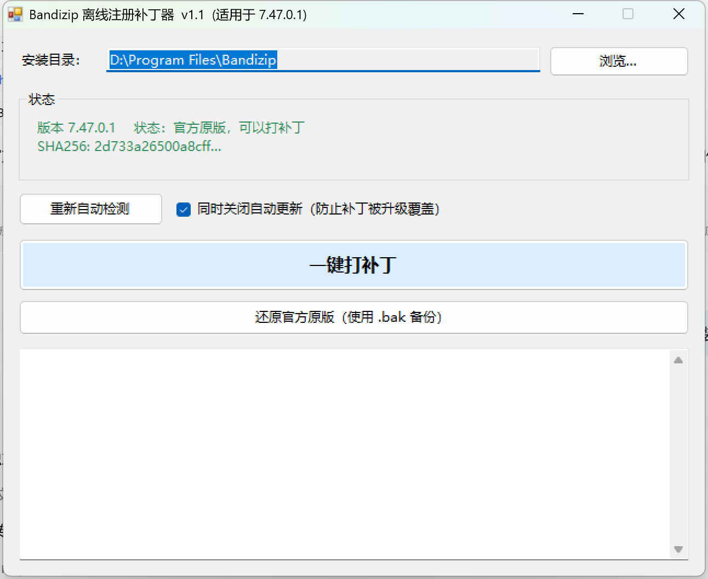
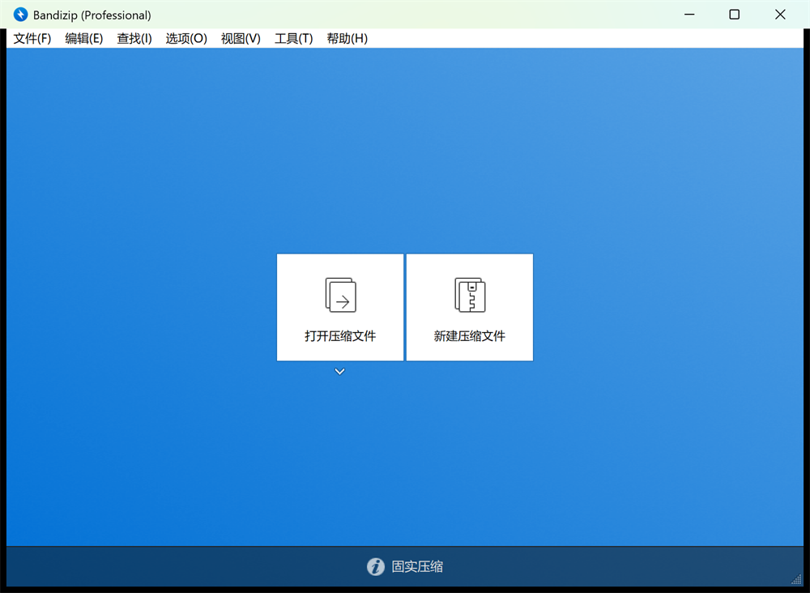

# Bandizip 离线注册补丁器

面向 **Bandizip 7.47.0.1 (Build 71912)** 的离线版授权补丁：一键把 Standard 版切换为 **Professional**，无需联网、不需要序列号，随时可还原官方原版。

> 本项目仅用于逆向学习与个人研究，请自行评估合规风险，详见文末[免责声明](#免责声明)。



打补丁后，Bandizip 标题栏显示 **Bandizip (Professional)**，广告子进程不再启动，Pro 功能按钮解锁：



---

## 下载

前往 **[Releases](https://github.com/1754164240/bandizip-pro-patcher/releases/latest)** 下载：

| 文件 | 说明 |
|---|---|
| `BandizipPatcher.exe` | 图形化一键补丁器（约 20 KB，需 .NET Framework 4.x，Windows 10/11 自带） |
| `SHA256SUMS.txt` | 校验和 |

也可以直接克隆仓库，用 `apply_patch.py`（Python 版，无需 .NET）：

```bash
git clone https://github.com/1754164240/bandizip-pro-patcher.git
cd bandizip-pro-patcher
python apply_patch.py            # 打补丁
python apply_patch.py --restore  # 还原官方原版
```

---

## 快速开始

1. 双击 `BandizipPatcher.exe`（会弹出 UAC 请求管理员权限，因为要写 `Program Files`）；
2. 程序自动定位安装目录 —— 依次检查注册表 `HKLM\SOFTWARE\Bandizip\ProgramFolder`、`App Paths`、运行中的进程、`%ProgramFiles%\Bandizip`；找不到时点「浏览…」手动选，或把安装文件夹**拖进窗口**；
3. 状态框会显示 `版本 7.47.0.1  状态：官方原版，可以打补丁`；
4. 点 **一键打补丁** → 确认，程序会：结束运行中的 Bandizip → 备份 `Bandizip.exe.bak` → 写入补丁 → 校验 SHA256 → 关闭自动更新 → 自动启动 Bandizip。

需要还原时点 **还原官方原版**，用 `.bak` 覆盖回去并校验哈希。

界面状态实时识别三种情况，避免误操作：

| 状态 | 含义 | 可用操作 |
|---|---|---|
| 官方原版 | 哈希或函数特征匹配 7.47.0.1 | 打补丁 |
| 已破解（Professional） | 哈希等于补丁版 | 还原 |
| 未识别的版本 / 文件 | 其它版本或已被篡改 | 全部禁用，不会写入任何字节 |

---

## 命令行 / 批处理

```
BandizipPatcher.exe                                    启动图形界面
BandizipPatcher.exe "D:\Program Files\Bandizip" /patch   /quiet
BandizipPatcher.exe "D:\Program Files\Bandizip" /restore /quiet
BandizipPatcher.exe /patch /quiet                      不带目录 = 自动检测
```

| 参数 | 作用 |
|---|---|
| `/patch`（默认） | 打补丁 |
| `/restore` | 还原官方原版 |
| `/silent` | 执行完弹提示框（60 秒自动关闭） |
| `/quiet` | 完全静默，用退出码表示结果（`0` 成功 / `1` 失败） |

也支持把安装文件夹或 `Bandizip.exe` 拖到 exe 图标上直接执行。

---

## 工作原理

### 授权判定链

| RVA | 作用 |
|---|---|
| `0xD0370` | `LoadLicense()`：读 `HKCU\Software\Bandizip\l`，解析 license 并填充全局 app 对象 |
| `0x1316C0` | **edition 映射函数**（本补丁的修改点） |
| `0x130F90` | edition 数值 → 显示名（Standard / Professional / Enterprise） |
| `0xCF570` / `0x131030` | 两个全局单例对象的 getter |

`LoadLicense()` 成功后，全局 app 对象上：

- `app+0x60` = `L"ok"` ⇒ license 有效
- `app+0x28` = `L"PRO"` / `L"ENT"` ⇒ 版本
- `app+0x50` = 32 字符 license code、`app+0x58` = 时间戳

`0x1316C0` 读取这两个字符串，做一次位混淆后写入单例 `+0x120`：

```
out = ((v >> 1) & 0x55555555) | ((v & 0xd5555555) << 1)

PRO -> v=0x3D4  -> out=1000   -> "Professional"
ENT -> v=0x1B20 -> out=10000  -> "Enterprise"
其它 -> v=0x98  -> out=100    -> "Standard"
```

窗口标题、广告开关、Pro 功能开关全部读取 `+0x120`。未注册时 license 字段为空、`HKLM\...\Edition = STD`，该值保持 `0x98` ⇒ 标题显示 `Bandizip (Standard)`。

### 补丁内容

把 `0x1316C0` 函数开头 78 字节替换为自写逻辑（函数原始长度 `0x157`，空间充足，**不新增节、不改 PE 头、文件大小不变**）：

```asm
push rbx
sub  rsp, 0x20                  ; x64 shadow space（漏掉会崩在 assign 内部）
mov  rbx, rcx                   ; this
call 0xCF570                    ; 取 app 单例
lea  rcx, [rax+0x60]
lea  rdx, [rip+0x2A6B40]        ; L"ok"
mov  r8d, 2
call 0x18F50                    ; std::wstring::assign
call 0xCF570
lea  rcx, [rax+0x28]
lea  rdx, [rip+0x2A6B38]        ; L"PRO"
mov  r8d, 3
call 0x18F50
mov  dword [rbx+0x120], 0x3D4   ; Professional
add  rsp, 0x20
pop  rbx
ret
```

设计要点：

- 复用程序自身的 `std::wstring::assign`（`0x18F50`），不手工拼 `std::wstring` 内存布局；
- `sub rsp,0x20` 必须保留，否则会踩坏调用者栈帧；
- 只用 RIP 相对寻址，天然兼容 ASLR；
- 修改后数字签名失效，但功能不受影响。

运行时验证（Frida 读内存）：

```
app+0x28 = "PRO"
app+0x60 = "ok"
单例+0x120 = 980  (0x3D4 -> 1000 -> Professional)
```

---

## 文件清单

```
BandizipPatcher.exe       图形化一键补丁器（Release 附件）
apply_patch.py            Python 版补丁脚本
src/BandizipPatcher.cs    补丁器源码（C# 5）
src/app.manifest          管理员权限清单
ui.png                    界面截图
```

自行编译（无需 Visual Studio，用系统自带 csc）：

```
csc /nologo /target:winexe /platform:x64 /codepage:65001 ^
    /win32manifest:app.manifest /optimize+ /out:BandizipPatcher.exe BandizipPatcher.cs
```

---

## 常见问题

**Q：提示「未识别的版本」，不能打补丁？**
只支持 `7.47.0.1 (build 71912)`。先确认 Bandizip 版本（帮助 → 关于），其它版本请勿使用。

**Q：更新/重装后又变回 Standard 了？**
升级会覆盖 `Bandizip.exe`，重新运行补丁器即可。补丁器默认会把 `HKCU\Software\Bandizip\update` 置 `0` 关闭自动更新。

**Q：能还原吗？**
可以。补丁器在首次打补丁时生成 `Bandizip.exe.bak`，点「还原官方原版」或 `apply_patch.py --restore` 即可，还原后哈希回到官方值 `2D733A26…91DC8`。

**Q：杀软报毒？**
补丁修改了已签名的商业程序，签名失效 + 代码段字节变化是典型触发点。添加到信任即可，源码完全公开可审计。

**Q：会影响 `bz.exe`、Bandiview、Uninstall.exe 吗？**
不会，只修改 `Bandizip.exe`。

---

## 校验和

| 版本 | SHA256 |
|---|---|
| 官方原版 7.47.0.1 | `2D733A26500A8CFF7DB04291C396B3D48E9D7275753E2A06BF3564C9F9591DC8` |
| 补丁版 | `E0D8170B17822AB611E87E7C021B83E22EAE6564C75B9E2BF8CFCCDB4B53D6AA` |

---

## 免责声明

本项目仅供**逆向工程与软件安全学习**使用，不得用于任何商业用途或二次分发破解版本。
Bandizip 是 Bandisoft International Inc. 的商业软件，请在试用后购买正版授权：<https://www.bandisoft.com/bandizip/>。
使用者应自行承担因使用本项目产生的一切后果，作者不对任何直接或间接损失负责。
